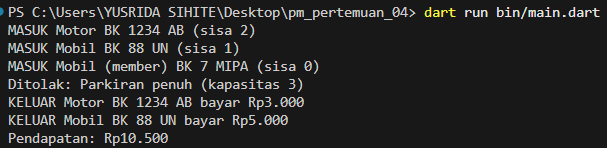

# Tugas Rutin 4 — Sistem Parkir Kampus

## Identitas

- **Nama:** Yusrida Jelianti Sihite
- **NIM:** 4243250048
- **Kelas:** PSIK 24C
- **Mata Kuliah:** Pemrograman Mobile

## Deskripsi

Sistem Parkir Kampus merupakan aplikasi console berbasis Dart untuk menyimulasikan proses masuk dan keluar kendaraan di area parkir FMIPA. Sistem mendukung kendaraan motor, mobil, truk, dan mobil member. Kapasitas parkir dibatasi, biaya dihitung berdasarkan durasi parkir dan tarif kendaraan, serta diskon 50% diberikan kepada member.

## Diagram Kelas

```text
          Kendaraan (abstract)
          - plat
          - waktuMasuk
          + jenis
          + tarifPerJam
          + biaya()
                  |
       +----------+----------+
       |          |          |
     Motor      Mobil       Truk
                  |
           MobilMember
                  |
          Berlangganan (mixin)

              Parkiran
          - kapasitas
          - _kendaraan
          - _pendapatan
          + masuk()
          + keluar()
          + sisa
          + pendapatan
```

## Screenshot Program

Simpan screenshot hasil program di `screenshots/hasil-parkir.png`.



## Enkapsulasi, Polimorfisme, dan Async Programming

Enkapsulasi diterapkan pada kelas `Parkiran` melalui field privat `_kendaraan` dan `_pendapatan`. Data kendaraan dikelola melalui method `masuk()` dan `keluar()`, sedangkan informasi kapasitas tersisa dan pendapatan dapat diakses melalui getter `sisa` dan `pendapatan`. Polimorfisme diterapkan melalui abstract class `Kendaraan` dan subclass `Motor`, `Mobil`, serta `Truk` yang memberikan implementasi getter `jenis` dan `tarifPerJam` sesuai jenis kendaraan. Daftar `List<Kendaraan>` di `main()` dapat menampung berbagai subclass tersebut. Mixin `Berlangganan` memberikan diskon 50% kepada `MobilMember`. Async programming diterapkan melalui method `masuk()` dan `keluar()` yang menggunakan `async`, `await`, dan `Future.delayed()` untuk menyimulasikan palang parkir. `StreamController.broadcast()` menyiarkan kejadian parkir kepada listener sehingga setiap aktivitas dapat ditampilkan di layar pos jaga. Exception `ParkirPenuh` digunakan untuk menangani kondisi ketika kapasitas parkir telah tercapai.

## Penggunaan AI

AI digunakan sebagai alat bantu dalam memahami konsep OOP, mixin, asynchronous programming, dan Stream pada Dart serta menyusun rancangan awal kode. Program diperiksa dan diuji kembali sebelum dikumpulkan.